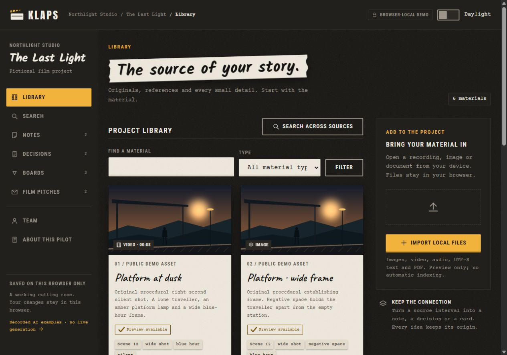

# KLAPS — browser pilot

This is a standalone, browser-only edition of the KLAPS film workspace. It keeps the Cutting Room interface and a complete sample workflow: material → search → source → note or decision → board → pitch. The default project, **The Last Light / Northlight Studio**, uses original procedural media and fictional production content.

The package runs on GitHub Pages. It does not require .NET, a server database, a model download, an API key or a build step. The ASP.NET Core/Blazor server pilot remains a separate application.



## Publish the ZIP on GitHub Pages

1. Extract the ZIP. Copy its **contents** into the root of a GitHub repository: `index.html`, the JavaScript and CSS files, `assets/`, `.nojekyll` and `.github/` must sit at repository root. Include hidden files and folders; do not put the whole package inside an extra directory.
2. Commit and push to `main`.
3. In the repository, open **Settings → Pages → Build and deployment → Source → GitHub Actions**.
4. Open **Actions → Deploy KLAPS to GitHub Pages**. The workflow runs on a push to `main`; **Run workflow** also starts it manually. When deployment finishes, GitHub displays the published address in **Settings → Pages** and in the deployment environment.

The workflow uses GitHub's Pages actions and uploads this standalone repository root. Publish the supplied public package only; do not add private application data, databases, invitations, credentials, full films or model files to this repository. The packaging process selects public files explicitly.

Alternatively, select **Deploy from a branch**, then `main` and `/(root)` in **Settings → Pages**. Keep `.nojekyll` at root. Use one publishing source at a time. No custom domain or `CNAME` is required. Asset paths are relative and navigation uses `#/…`, so the same files work at a repository Pages subpath without server rewrite rules.

GitHub's instructions: [create a GitHub Pages site](https://docs.github.com/en/pages/getting-started-with-github-pages/creating-a-github-pages-site) and [configure the publishing source](https://docs.github.com/en/pages/getting-started-with-github-pages/configuring-a-publishing-source-for-your-github-pages-site).

## Try the workspace

- **Library:** filter the sample materials or import local files. Open a material to inspect its preview and selected interval, then create a source-linked note, decision or board card.
- **Search:** use local text search, or select one of the recorded vector queries. The vector mode ranks saved 768-dimensional visual/audio vectors in your browser using a saved query vector. It does not run an embedding model or embed a new query.
- **Notes and decisions:** write observations, record a rationale and resolve a decision. References keep the chosen material and interval.
- **Board:** add cards and move them among Research, Develop and Ready with buttons. Changes remain in this browser.
- **Pitches:** write a pitch, save an immutable new version, compare versions and select a preferred version. A recorded Qwen draft can be copied into your local history with its recorded-AI origin intact. Export the selected pitch as a standalone HTML reading page.
- **Project backup:** export the project as JSON and restore it in this browser or another browser. Read the media limitations below before relying on a backup.
- **Team:** inspect fictional collaborators. This screen does not grant access or create accounts.
- **Theme:** switch between Table and Daylight; the browser remembers the choice when storage is available.

The vector reference study uses numerical evidence from the existing *Dzień świra* experiment. The package contains no footage, stills or soundtrack from that film. Source intervals and cosine scores describe that saved experiment. Similarity is model proximity, not a quality score or proof of narrative continuity.

The recorded pitch was genuinely generated by the local Qwen3.5-9B model before this package was made. It is an editorial proposal and can contain inconsistencies. No new AI inference runs on GitHub Pages. The public evidence is `assets/evidence/actual-ai-generation.public.json` and `assets/evidence/recorded-index.public.json`; [ASSET-MANIFEST.json](assets/evidence/ASSET-MANIFEST.json) records source paths, transformations and SHA-256 checksums.

## Local data and backups

Edits belong to this browser and this site origin. They are not sent to a studio server and are not shared with another person, browser or device. GitHub Pages serves the same sample files to visitors; it does not save their project changes back to the repository. There is no login, MFA, membership enforcement, shared editing or live collaboration in this edition.

Project records use browser storage. Imported file bytes use IndexedDB when available; if persistence is unavailable, the interface reports the limitation and uses its available fallback. A file may remain usable only for the current session. Browser privacy settings, storage limits or clearing site data can remove local work. Keep explicit JSON backups of changes you want to retain.

**JSON backups do not contain imported file blobs.** They preserve the project records and imported-file metadata. After a restore, reselect the original local files to reconnect their previews. Demo assets are part of this package and remain available. Keep your original imported files separately. A pitch HTML export is a reading document, not a complete project backup.

Reset restores the shipped example after confirmation. It affects local demo data, not a server project. Export a backup first if you want to keep your edits.

## Run locally

Serve the extracted directory with any static web server. For example, from that directory:

```sh
python -m http.server 8000
```

Open `http://localhost:8000`. All runtime assets are supplied locally; no CDN is needed. Browser storage is scoped to the address, so changing the host, port or Pages repository creates a separate local workspace. This package does not install an offline cache or service worker.

## Scope and attribution

GitHub Pages hosts static files. The server pilot's account/MFA flows, Finbuckle tenancy, authorization, database, upload processing, durable jobs and local model workers require its server host and are not running here. Browser imports provide previews and metadata; they do not perform the server's indexing pipeline. Text search and recorded vector ranking have distinct labels.

The visual source is the project-owned **KLAPS Cutting Room** handoff. Its copied tokens, component stylesheet and font binaries remain unchanged; browser composition and behavior are project adaptations. Font licenses and provenance are retained; see [THIRD-PARTY-NOTICES.txt](THIRD-PARTY-NOTICES.txt). The package does not redistribute the .NET application, Finbuckle, React or model weights.

Automated browser checks, when recorded with the delivery, cover only their stated cases. They do not establish complete accessibility or production acceptance. Full keyboard, screen-reader and physical-device review remain separate acceptance work.


## Validation of this export

See `VALIDATION.json` for 15 DOM-free integration checks and `BROWSER-VALIDATION.json` for the bounded browser exercise, including source intervals, persistence, import, decisions, board moves, pitch revisions/comparison/export, and 400px themes. No deployment or full accessibility acceptance is implied.
